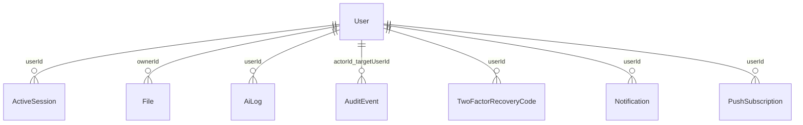

# Entidades — Boilerplate Webapp

Modelagem de dados para agentes de IA. **Leia antes de alterar Prisma, relações ou invariantes de persistência.** Regras de produto: [`CONTEXT.md`](CONTEXT.md). Camadas e transações: [`CONTEXT-ARCHITECTURE.md`](CONTEXT-ARCHITECTURE.md).

Snapshot: **2026-10-26**.

Fonte única do shape: `prisma/models/*.prisma`. `npm run prisma-merge` gera `prisma/schema.prisma` — **não editar o gerado**. Banco: MongoDB com replica set (ADR-006). Campo novo se documenta no `///` do model, sem copiar o schema aqui.

## Modelo

Sem relações Prisma declaradas: o vínculo é por `ObjectId` guardado (`userId`, `ownerId`). Exclusão em cascata é feita pelo código (`retention-purge`), não pelo banco.

## Coleções

| Model                   | Papel                                                                                             |
| ----------------------- | ------------------------------------------------------------------------------------------------- |
| `User`                  | Conta. Soft delete por `deletedAt` (quarentena de 30 dias); depois anonimizada                    |
| `ActiveSession`         | Sessões JWT listáveis (`jtiHash` único, `exp`)                                                    |
| `SessionEvent`          | Revogações/logouts por `token` (hash do jti) com `exp`; consultado a cada requisição autenticada  |
| `File`                  | Registro de objeto no Spaces (`key` único, `status`, `sizeBytes`, `thumbnailKey/Url`)             |
| `FeatureFlag`           | Append-only por `key`; vigente = mais recente                                                     |
| `TwoFactorRecoveryCode` | Código de recuperação do 2FA (só o hash SHA-256; `usedAt` no uso; `@@unique([userId, codeHash])`) |
| `AuditEvent`            | Trilha de auditoria append-only (ação, ator, alvo, IP, `requestId`). Ver abaixo                   |
| `AiLog`                 | Auditoria de chamada de IA (prompt, resposta, tokens). Conteúdo do usuário                        |
| `Notification`          | Sino in-app                                                                                       |
| `PushSubscription`      | Aparelho inscrito no Web Push (`endpoint` único)                                                  |
| `Example`               | Exemplo de arquitetura (não é domínio)                                                            |

## Invariantes

### `User`

- `email` e `nickname` únicos. Nickname é guardado normalizado; busca usa a forma canônica. Após o hard purge: `email = deleted_<id>@invalid.local`, `nickname = deleted_<id>` (libera os únicos).
- **Soft delete:** `deletedAt` pode ser `null` **ou ausente**. Toda consulta de "usuário ativo" usa `activeWhere`/`NOT_DELETED_WHERE` (`{ deletedAt: null } OR { deletedAt: { isSet: false } }`). Nunca assuma que o campo existe.
- **Campo novo é opcional.** No MongoDB, campo obrigatório ausente em documento antigo quebra a leitura. Padrão: opcional + normalização no código + script de backfill (`role UserRole?` + `normalizeUserRole` + `npm run user-role:backfill`).
- `role`: `USER` | `ADMIN`; ausente conta como `USER`.
- `photoUrl` e `photoThumbnailUrl` guardam a URL **canônica** (não assinada). `photoThumbnailUrl` é ausente em avatares anteriores ao pipeline de imagem; a UI cai para `photoUrl`. Assinatura acontece na saída (`withSignedPublicUser`).
- `sessionsRevokedAt`: sessões com `iat` anterior são recusadas.
- `emailTokenHash` guarda o SHA-256 do código; o código cru nunca é gravado. `emailTokenPurpose`: `verify` | `change_old` | `change_new` | `password_reset`.
- `dateOfBirth` e `ageVerifiedAt` não saem em DTO público. `settings` é uma lista `{ key, value }` (só `darkMode` e `language`).
- DTO público: `PublicUser` via `toPublicUser` (allowlist; teste em `tests/repositories/publicUser.dto.test.ts`). Checklist: [`docs/dto-checklist.md`](docs/dto-checklist.md).

### `File`

- `key` único: `{ownerId}/{categoria}/{hash}.webp` (e `{hash}.thumb.webp` em `thumbnailKey`). Legados podem ter outras extensões e não ter thumbnail.
- `sizeBytes` = principal + thumbnail; só `status = published` conta na cota (1 GiB).
- Ciclo: `pending` → `published` | `failed`; `orphan` quando substituído/removido; o `retention-purge` apaga os objetos de órfãos com mais de 7 dias (as **duas** chaves).

### 2FA (`User.twoFactor*` e `TwoFactorRecoveryCode`)

- `User.twoFactorEnabledAt` (ativo), `twoFactorSecretEnc` (segredo TOTP cifrado `v1.iv.tag.dados`), `twoFactorPendingSecretEnc` (setup não confirmado) e `twoFactorLastStep` (último passo aceito: impede replay). **Nada disso sai pela API**, nem pela exportação; `UserEntity` só expõe `twoFactorEnabledAt`.
- Consumo de passo e de código de recuperação é atômico (`updateMany` condicional). Desativar apaga segredo e códigos. O hard purge da conta zera os campos e apaga os códigos.

### `AuditEvent`

- Append-only: o repository só tem `record` e consultas; nunca `update`/`delete` por evento. `record` **não lança** (falha de auditoria só vira log). Guarda `action` (`AUDIT_ACTIONS` em `src/constants/audit.ts`), `actorType` (`user|admin|operator|system`), `actorId?`, `targetUserId?`, `metadata?` (curto, não sensível), `ip?` e `requestId?` (do contexto da requisição; ausentes em scripts).
- Nunca guarda senha, token, e-mail nem corpo de requisição. A API de admin não devolve `ip`, `requestId` nem `metadata`.
- Dado pessoal: entra na exportação LGPD (`auditEvents`, sem o id da outra parte), o **IP é zerado** na exclusão definitiva da conta (o evento fica) e os eventos vencem em **365 d** (`AUDIT_LOG_RETENTION_DAYS`, `retention-purge`). [`docs/operators/audit-log.md`](docs/operators/audit-log.md).

### `AiLog`, `Notification`, `PushSubscription`

- Dado pessoal: entram na exportação LGPD (exceto `endpoint`, `p256dh` e `auth` da assinatura) e são apagados no hard purge da conta. Retenção: `AiLog` 90 d, `Notification` 180 d.
- `PushSubscription.endpoint` é único: reinscrever o mesmo aparelho por outra conta **transfere** a assinatura. Máximo de 10 por usuário. `p256dh`/`auth` são segredo: nunca em log nem export.
- `Notification.link` é caminho interno (`isSafeInAppLink`).

### `FeatureFlag`

Nunca atualizar nem apagar: toda mudança é um registro novo. Chave ausente = desligada.

## Índices e performance

Índices declarados nos próprios models (`@@index`/`@@unique`); veja [`docs/operators/prisma-indexes.md`](docs/operators/prisma-indexes.md) e [`docs/operators/database-pool.md`](docs/operators/database-pool.md) para o pool por instância.

## Como manter este arquivo

Model, campo com regra própria ou invariante nova → atualize a seção do model e a data do snapshot. Mudança de schema também pede: DTO (`User.dto.ts` quando público), exportação (`exportUserData`), purge (`retention-purge.mjs`) e, em `User`, o padrão opcional + backfill acima.
